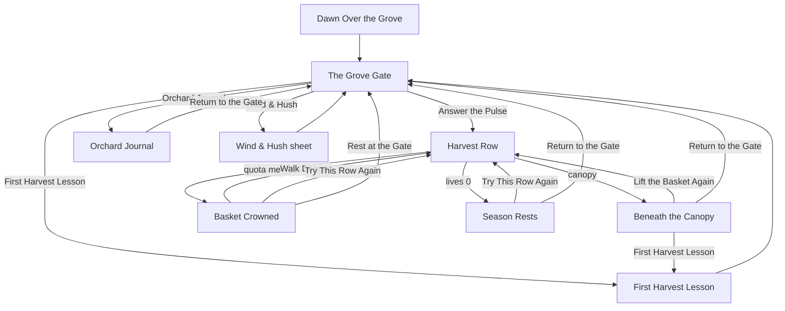

# Echo Orchard — Game Design Document

## One-line pitch

Tap in sync with each tree’s hidden pulse to harvest ripe fruit into your basket before the season turns.

---

## Core concept

**Echo Orchard** is a rhythm-timing harvest game set in a cozy hillside orchard. Each tree has its own heartbeat — a repeating pulse you see as a glowing ring and feel through gentle haptics. Watch the pulse, tap when the ring aligns with the “ripe moment,” and fruit drops into your woven basket. Miss the moment or tap a decoy branch and the fruit bruises, costing a life.

There is no combat, no scrolling reflex chaos, and no reading sheet music. The skill is **listening with your eyes**: learn each tree’s tempo, respect wind gusts that nudge timing, and chain perfect harvests for bonus fruit.

---

## Gameplay loop

1. **Arrive at a harvest row** — one to three trees stand across the screen, each with a fruit quota.
2. **Study the pulse** — a ring expands from the trunk on a fixed beat (BPM). A subtle `SystemSound` tick and `HapticFeedback` selection pulse reinforce timing (visual-only mode available in **Wind & Hush**).
3. **Tap to harvest** — when the ring overlaps the golden “ripe band,” tap the tree (or its active fruit cluster). A perfect center tap yields two fruit; a good edge tap yields one.
4. **Fill the basket** — reach the row quota before you lose all three **lives** (bruised fruit).
5. **Earn stars** — up to three per row based on perfect ratio, lives remaining, and quota speed.
6. **Unlock the next row** — progress through four **seasons** of five rows each (20 rows total).

Repeat: pulse → tap → basket fills → row cleared → deeper into the orchard.

---

## How the game works (player-facing)

### The pulse

Every tree runs an internal metronome defined by level data (beats per minute). Visually:

- A **trunk core** (drawn circle) anchors the tree.
- An **echo ring** scales from 0.4× to 1.0× trunk radius on each beat cycle.
- A **ripe band** (static golden arc/ring segment) marks the valid tap window on the cycle.

When the echo ring’s leading edge enters the ripe band, the tree is **harvestable** until the ring exits. Tap outside that window → **bruised fruit** (life lost, brown particle burst). Tap inside → fruit flies along a code-drawn arc into the basket.

### Trees and fruit

Trees are code-drawn: rounded trunk rectangle, radial leaf blob (green gradient), and circular fruit dots (red apple, gold pear, purple plum — colors only, no sprites). Each tree shows a small **remaining fruit** counter as leaf-shaped badges.

### Decoy branches (later rows)

Some trees sprout a **withered branch** (desaturated brown twig with grey fruit). Tapping it always bruises fruit. The withered branch pulses **out of sync** with the true rhythm as a visual hint.

### Wind gusts (later rows)

A **wind ribbon** (horizontal gradient streak) occasionally slides across the row. While active, every tree’s ripe band shifts ±80–150 ms for 2–3 beats. A small **wind vane** HUD icon tilts to warn players.

### Lives and basket

- **Lives:** 3 per row. Bruised tap or empty tap on a non-harvestable moment costs 1 life.
- **Basket:** Woven rectangle at bottom center; fruit dots animate in. Quota shown as `filled / needed`.
- **Win row:** `filled >= needed` before lives hit 0.
- **Lose row:** lives hit 0 before quota met.

### Perfect streak

Three consecutive perfect taps grant **+1 bonus fruit** (once per streak chain; streak resets on good/bruised). Displayed as a glowing **triple leaf** badge near the basket.

---

## Play, pause, and resume

| State | Behavior |
|-------|----------|
| **Playing** | Pulse timers run; wind gusts advance; tap input active. |
| **Pause** | Triggered via canopy button (top-right) or app lifecycle `paused`. All pulse timers freeze; wind frozen; input ignored. Dim overlay + **Beneath the Canopy** sheet. |
| **Resume** | **Lift the Basket Again** clears overlay; timers resume from exact elapsed phase (no time lost, no catch-up ticks). |
| **Row complete / Season Rests** | Gameplay frozen; overlay results. |
| **Background** | Auto-pause (same as manual pause). |

Implementation note: store each tree’s pulse phase (`elapsed % beatPeriod`) on pause; restore on resume.

---

## Screens

Every screen uses **Fraunces** typography and code-drawn orchard visuals (gradients, shapes, emoji accents). No external art files.

### 1. Dawn Over the Grove (Splash)

**Emotional goal:** Quiet anticipation — morning mist, the day’s harvest ahead.

**Layout (not a centered button list):**

- Full-screen **dawn gradient** (cream sky → pale green horizon).
- Bottom 40%: rolling **hill silhouette** (`CustomPainter` bezier hills) in deep leaf green.
- Upper center: title **Echo Orchard** in large Fraunces; subtitle “Answer the Pulse” smaller beneath.
- Three **mist layers** (semi-transparent white ovals) drift slowly upward (implicit animation, 4 s loop).
- A single **lantern dot** (small yellow circle) bobs at left third — acts as loading indicator.
- Auto-advance to **The Grove Gate** after 2.5 s or on tap anywhere.

**Eye path:** gradient sky → title → hills → lantern motion.

---

### 2. The Grove Gate (Main Menu)

**Emotional goal:** Belonging — you live in this orchard; navigation is spatial, not a vertical menu.

**Layout (surprise factor — horizontal grove map, not stacked buttons):**

- **Panorama row** occupies 70% height: three code-drawn trees at left, center, right thirds, connected by a winding **dirt path** (tan bezier strip).
- **Sky strip** top 15%: season name of last unlocked season (e.g., “Spring Bloom”) + small star total.
- **Interactive hotspots** (large touch targets on path segments):
  - **Left path segment → “Answer the Pulse”** — starts next uncleared row (or last played).
  - **Center stump → “Orchard Journal”** — progression map.
  - **Right path segment → “Wind & Hush”** — settings sheet slides up.
- **Bottom-left floating leaf chip → “First Harvest Lesson”** — how-to overlay.
- **Bottom-right** woven basket icon showing total stars collected (tap opens Journal filtered to stars).

Trees gently **scale-breathe** (0.98–1.02, 3 s) independently. No “Play” button anywhere.

**Eye path:** panorama trees → center stump → path segments left/right.

---

### 3. Harvest Row (Gameplay)

**Emotional goal:** Focused calm — rhythm, not frenzy.

**Layout:**

- **Top 12% HUD bar** (rounded rectangle, frosted fill):
  - Left: row label “Row 7 · Summer Sun”
  - Center: basket quota `🧺 4 / 9` (emoji + numbers)
  - Right: three **life leaves** (green filled / brown empty)
- **Middle 68% playfield:** trees evenly spaced on grass gradient. Each tree: trunk, leaf mass, fruit dots, echo ring, ripe band. Withered decoy branch offset left/right when present.
- **Wind ribbon** renders behind trees when active (translucent white streak).
- **Bottom 20%:** large woven **basket** (`CustomPainter` crosshatch) centered; fruit dots land here. **Perfect streak** triple-leaf badge floats above basket when active.
- **Top-right canopy icon** (Material `park` or code-drawn arc) — pause hit target 48 dp.

**Eye path:** quota → active tree rings → basket.

**Input:** Tap tree hit area (trunk + fruit cluster circle). Multi-tree rows: only the tapped tree evaluates timing.

---

### 4. Beneath the Canopy (Pause)

**Emotional goal:** Rest — shade, still air.

**Layout:**

- Semi-transparent **leaf-shadow overlay** (dark green 60% opacity) over frozen gameplay.
- Center card (not full screen): rounded rectangle like a hanging sign.
  - Title: **Beneath the Canopy**
  - Three horizontal **wood-chip buttons** (tan fill, dark text):
    - **Lift the Basket Again** (resume)
    - **Return to the Gate** (main menu, confirm dialog if mid-row)
    - **First Harvest Lesson** (how-to, resumable)
- Background gameplay visibly frozen (rings mid-expand).

---

### 5. Basket Crowned (Level Complete)

**Emotional goal:** Satisfaction — fullness, accomplishment.

**Layout:**

- Gameplay dimmed; **golden hour gradient** washes in from top.
- Large **basket** center-top overflowing with fruit dots (physics-less stack animation).
- **Star row** below basket: three star icons (Material `star` / `star_border`) fill in sequentially with scale bounce.
- Stats line: “Perfect echoes: 68% · Lives left: 2”
- Bottom **split path buttons**:
  - Left stump: **Try This Row Again**
  - Right path: **Walk Deeper** (next row) or **Rest at the Gate** if final row of season
- Season-complete variant (row 5, 10, 15, 20): banner **“{Season} Crowned”** + confetti dots (code particles, 1.5 s).

---

### 6. Season Rests (Game Over)

**Emotional goal:** Gentle failure — season pauses, not punishment.

**Layout:**

- Cool **dusk gradient** (not harsh red).
- Wilted **single leaf** icon center (brown, slow rotate).
- Copy: **“The basket spilled — season rests.”**
- Subtext: bruised count + near-miss percentage (encouraging, not shaming).
- Buttons on ** fallen log** bar:
  - **Try This Row Again**
  - **Return to the Gate**

No lives counter punishing language.

---

### 7. Orchard Journal (Progression)

**Emotional goal:** Growth over time — your orchard story.

**Layout (vertical scroll, but structured as journal pages — not a generic list):**

- Header: **Orchard Journal** + total stars.
- Four **season spreads** (accordion cards):
  - Left margin: season emoji + name (🌸 Spring Bloom, ☀️ Summer Sun, 🍂 Autumn Gold, ❄️ Winter Quiet)
  - Five **row stamps** per season (circle stamps: empty / 1–3 stars filled)
  - Tap stamp → replay that row (if unlocked)
- Locked seasons: desaturated card + “Complete prior season to unlock.”
- Back: top-left **Return to the Gate** leaf button.

---

### 8. First Harvest Lesson (How to Play)

**Emotional goal:** Teach rhythm without walls of text.

**Layout (horizontal pager, 4 pages):**

1. **“Every tree has a pulse.”** — Diagram: trunk + expanding ring animation loop.
2. **“Tap when the ring meets gold.”** — Ripe band highlighted; perfect vs good vs bruised labels.
3. **“Fill the basket before lives run out.”** — Basket + life leaves diagram.
4. **“Wind and withered branches lie.”** — Wind ribbon + decoy branch callouts.

Bottom: dot pager + **Return to the Gate** (or **Lift the Basket Again** if opened from pause). Swipe or arrow chips to navigate.

---

### 9. Grove Promise (Privacy Policy)

**Emotional goal:** Trust — plain language, offline honesty.

**Layout:**

- Scrollable parchment card on green background.
- Title: **Grove Promise**
- Short sections: No data collected · No network · No accounts · Local progress only · Contact placeholder (developer email string in constants).
- **Return to the Gate** at bottom.

Offline game; policy fits on one scroll.

---

### 10. Wind & Hush (Settings)

**Emotional goal:** Personal comfort — tune sensory feedback.

**Layout (bottom sheet from Grove Gate):**

- Title: **Wind & Hush**
- Toggles (theme-styled switches on wood rows):
  - **Pulse Tick** — `SystemSound` on/off (default on)
  - **Harvest Tremor** — `HapticFeedback` on/off (default on)
  - **Eyes-Only Rhythm** — visual pulse emphasis, mutes tick (accessibility)
  - **Gentle Wind** — reduce wind gust frequency (assist)
- **Grove Promise** link text at bottom.
- Swipe down or **Close the Breeze** chip to dismiss.

All settings stored locally via `shared_preferences`.

---

## UI / UX flow

---

## Level structure and progression

### Seasons and rows

| Season | Rows | Theme tint | New mechanic intro |
|--------|------|------------|-------------------|
| Spring Bloom | 1–5 | Pink-green dawn | Single tree, wide window, slow BPM (50–65) |
| Summer Sun | 6–10 | Warm yellow-green | Two trees, medium window, BPM 65–80 |
| Autumn Gold | 11–15 | Orange-green | Decoy branches + wind gusts |
| Winter Quiet | 16–20 | Cool blue-green | Three trees, narrow window, polyrhythm BPM |

Row 1 always unlocked. Clearing row N unlocks row N+1. Clearing row 5/10/15 unlocks next season’s row 1.

### Level data (per row)

Each row JSON entry:

- `id`, `season`, `rowInSeason`
- `trees[]`: `{ bpm, fruitCount, fruitType, hasDecoy, decoyPhaseOffset }`
- `quota` (sum of fruit minus optional bonus margin — default equals total fruit)
- `wind`: `{ enabled, intervalSec, shiftMs }`
- `windowMs`: perfect/good timing windows
- `starThresholds`: `{ perfectPct, minLives }`

### Difficulty scaling

| Dimension | Early (Row 1) | Mid (Row 10) | Late (Row 20) |
|-----------|---------------|--------------|---------------|
| BPM | 50 | 75 | 95 |
| Trees | 1 | 2 | 3 |
| Good window | ±180 ms | ±120 ms | ±90 ms |
| Perfect window | ±60 ms | ±40 ms | ±25 ms |
| Decoys | none | 50% trees | all trees |
| Wind | off | every 12 s | every 8 s, ±150 ms shift |
| Quota pressure | quota = fruit − 1 | quota = fruit | quota = fruit (no margin) |

---

## Scoring, stars, and win/lose

### Fruit values

| Tap quality | Fruit gained | Notes |
|-------------|--------------|-------|
| Perfect (center of ripe band) | 2 | Contributes to perfect streak |
| Good (edge of ripe band) | 1 | Breaks perfect streak |
| Bruised / decoy / empty | 0, −1 life | Brown burst particle |

### Stars (per row)

| Stars | Condition |
|-------|-----------|
| ⭐ | Row cleared (quota met) |
| ⭐⭐ | Cleared with ≥2 lives remaining |
| ⭐⭐⭐ | Cleared with ≥60% perfect taps (or season threshold from data) |

Stars persist locally; best result per row kept.

### Win condition

`basketCount >= quota` while `lives > 0`.

### Lose condition

`lives == 0` before quota met.

---

## Persistence (offline)

Store via `shared_preferences` (or `hive_ce` if structured data grows):

- Highest unlocked row id
- Per-row best stars (0–3)
- Settings: pulse tick, haptic, eyes-only, gentle wind
- Last played row (for **Answer the Pulse** shortcut)

No network, no accounts, no analytics.

---

## Audio and haptic feedback (no media files)

| Event | Feedback |
|-------|----------|
| Pulse beat (tick) | `SystemSound.play(SystemSoundType.click)` if Pulse Tick on |
| Perfect harvest | `HapticFeedback.mediumImpact()` + click |
| Good harvest | `HapticFeedback.lightImpact()` |
| Bruised | `HapticFeedback.heavyImpact()` |
| Row win | `SystemSound.play(SystemSoundType.alert)` + medium impact |
| Row lose | Soft `click` only |

**Eyes-Only Rhythm** disables sounds but keeps visual pulse emphasis (thicker ripe band glow).

---

## Technical notes for developers

- **Engine:** Flutter 3.44 + Flame ^1.37.0 for gameplay loop and tap detection; Flutter widgets for menus/overlays.
- **Pulse math:** `beatPeriod = 60000 / bpm` ms; phase advances with `dt` unless paused; wind adds temporary offset to ripe band start/end.
- **Hit test:** Compare tap timestamp to `(phase + windOffset) mod beatPeriod` against `[bandStart, bandEnd]`.
- **No custom assets v1:** trees, fruit, basket, rings drawn in Flame `Canvas` or `CustomPainter`.

---

## Copy sheet

| String | Function |
|--------|----------|
| Echo Orchard | App title |
| Answer the Pulse | Subtitle / start harvest CTA |
| Dawn Over the Grove | Splash screen title (internal) |
| The Grove Gate | Main menu |
| Answer the Pulse | Begin next row (main menu left path) |
| Orchard Journal | Progression screen |
| Wind & Hush | Settings sheet |
| First Harvest Lesson | How to play |
| Grove Promise | Privacy policy |
| Harvest Row | Gameplay screen (internal) |
| Beneath the Canopy | Pause menu title |
| Lift the Basket Again | Resume |
| Return to the Gate | Main menu navigation |
| Close the Breeze | Dismiss settings |
| Basket Crowned | Level complete title |
| Walk Deeper | Next row |
| Try This Row Again | Retry row |
| Rest at the Gate | Exit to menu after win |
| Season Rests | Game over title |
| The basket spilled — season rests. | Game over body |
| Spring Bloom | Season 1 name |
| Summer Sun | Season 2 name |
| Autumn Gold | Season 3 name |
| Winter Quiet | Season 4 name |
| Row {n} | Row label in HUD |
| Perfect echoes: {pct}% | Results stat |
| Lives left: {n} | Results stat |
| {Season} Crowned | Season complete banner |
| Complete prior season to unlock. | Locked season hint |
| Every tree has a pulse. | How-to page 1 |
| Tap when the ring meets gold. | How-to page 2 |
| Fill the basket before lives run out. | How-to page 3 |
| Wind and withered branches lie. | How-to page 4 |
| Pulse Tick | Settings: sound toggle |
| Harvest Tremor | Settings: haptic toggle |
| Eyes-Only Rhythm | Settings: visual-only accessibility |
| Gentle Wind | Settings: reduced wind assist |
| No data collected | Privacy bullet |
| No network | Privacy bullet |
| No accounts | Privacy bullet |
| Local progress only | Privacy bullet |
| 🧺 {filled} / {needed} | Basket quota HUD |
| Perfect! | Floating perfect feedback |
| Good harvest | Floating good feedback |
| Bruised… | Floating bruised feedback |
