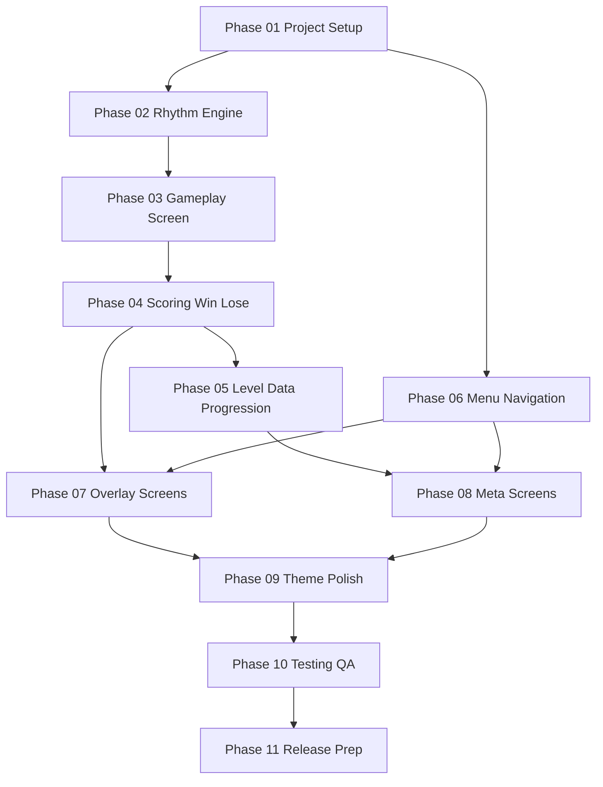

# Echo Orchard — Implementation Plan

Build **Echo Orchard** phase by phase: Flutter 3.44, Dart 3.12.0, Flame ^1.37.0, `shared_preferences` ^2.5.5, bundled Fraunces fonts. Each phase file in `docs/phases/` is self-contained for a build sub-agent.

**Simplest path:** Flame handles Harvest Row timing and drawing; Flutter widgets handle menus/overlays; one `GameRouter` (or go_router) connects screens; row data lives in a static Dart map or JSON asset (JSON is a text asset — allowed as data, not media art).

---

## Phase list

| # | Name | Summary | Depends on |
|---|------|---------|------------|
| 01 | [project-setup](phases/phase-01-project-setup.md) | Flutter + Flame shell, fonts, routing stub, `debugShowCheckedModeBanner: false` | none |
| 02 | [rhythm-engine](phases/phase-02-rhythm-engine.md) | Pulse timers, ripe-band math, wind offset, hit evaluation | 01 |
| 03 | [gameplay-screen](phases/phase-03-gameplay-screen.md) | Harvest Row: draw trees/rings, tap input, basket UI | 02 |
| 04 | [scoring-win-lose](phases/phase-04-scoring-win-lose.md) | Lives, quota, perfect/good/bruised, stars, row end states | 03 |
| 05 | [level-data-progression](phases/phase-05-level-data-progression.md) | 20 rows data, unlock rules, `shared_preferences` persistence | 04 |
| 06 | [menu-navigation](phases/phase-06-menu-navigation.md) | Dawn splash + Grove Gate spatial menu + navigation | 01 |
| 07 | [overlay-screens](phases/phase-07-overlay-screens.md) | Beneath the Canopy, Basket Crowned, Season Rests | 04, 06 |
| 08 | [meta-screens](phases/phase-08-meta-screens.md) | Orchard Journal, First Harvest Lesson, Grove Promise, Wind & Hush | 05, 06 |
| 09 | [theme-polish](phases/phase-09-theme-polish.md) | Full design language, particles, haptics, SystemSound | 07, 08 |
| 10 | [testing-qa](phases/phase-10-testing-qa.md) | Manual QA matrix, edge cases, pause/lifecycle | 09 |
| 11 | [release-prep](phases/phase-11-release-prep.md) | Launcher icon, portrait lock, store metadata stub, release APK/AAB | 10 |

---

## Dependency graph

**Parallel opportunities:**

- Phase **06** can run alongside **02 → 04** once Phase 01 is done.
- Phase **08** can start when **05 + 06** are done, parallel to late **07** work.

---

## Status table

| Phase | Status | Notes |
|-------|--------|-------|
| 01 — project-setup | done | Flutter 3.41.6, flame 1.37.0, Fraunces bundled |
| 02 — rhythm-engine | done | lib/game/rhythm/* + unit tests |
| 03 — gameplay-screen | done | HarvestGame + tree/basket components |
| 04 — scoring-win-lose | done | HarvestSession, win/lose navigation |
| 05 — level-data-progression | done | 20 rows in rows.dart, shared_preferences |
| 06 — menu-navigation | done | Splash + Grove Gate spatial menu |
| 07 — overlay-screens | done | Pause, Basket Crowned, Season Rests |
| 08 — meta-screens | done | Journal, Lesson, Privacy, Wind & Hush |
| 09 — theme-polish | done | Palette, Fraunces, HUD, feedback |
| 10 — testing-qa | pending | |
| 11 — release-prep | pending | |

---

## Build order (recommended)

1. **01** → **02** → **03** → **04** (core loop playable)
2. **06** in parallel with **02–04** if multiple agents
3. **05** → **07** → **08** → **09** → **10** → **11**

After Phase 04, a developer should be able to play one hard-coded row in isolation. After Phase 09, the game is feature-complete for store submission prep.
